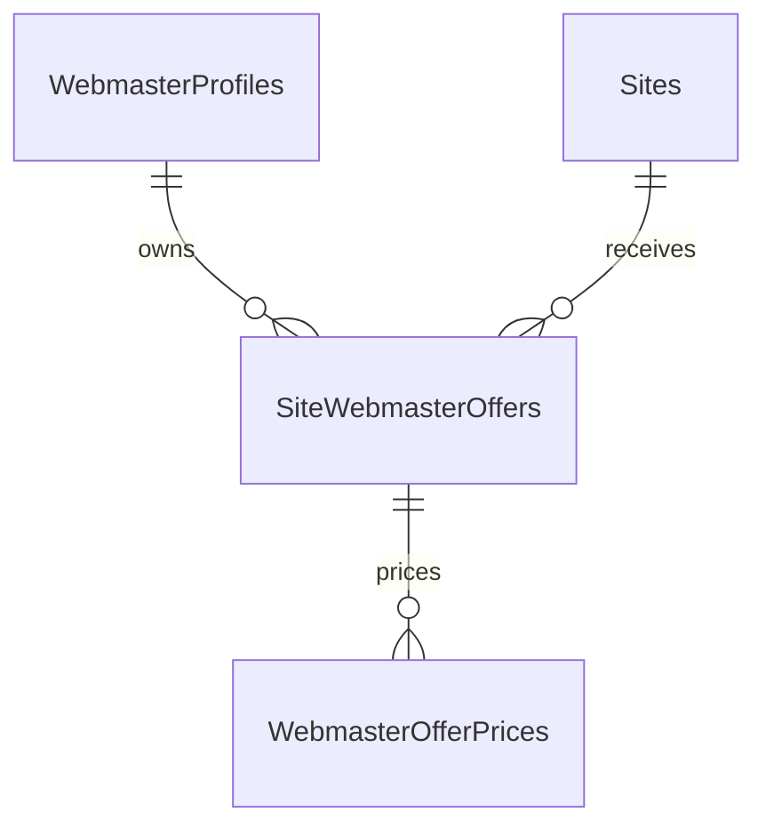

# Webmaster profiles: paused-task handoff

Paused by the user on **2026-11-03**, pending a conversation with the business.
Do not implement or deploy the migration until the user resumes and supplies the business decisions.
Read this file only when resuming this task; it is not a general product specification.

## Checkout and implementation status

* Repository: `C:/work/redhead-catalog-app`.
* Task branch: `codex/webmaster-primary-profiles`, created from `main` at `aeccf4a`.
* This checkpoint contains research and planning documents only. No WebmasterProfile EF entities,
  application migration, grouped UI, or new editing behavior has been implemented.
* Existing primary-contact cleanup migrations were already applied in the production dump.
* Unrelated local changes predate this task: modified `README.md` and untracked
  `scripts/Test-LinkDetectiveBatch.ps1`. They are not part of the task/checkpoint; do not discard,
  stage, or stash them without inspecting ownership and the user's intent.

## Problem and business context

The current Webmasters page groups by technical `WebmasterId`. Import identifies that row by
normalized raw Contact, so variations of the same contact create several search results for one
business partner. The user explicitly wants one profile/result per saved primary contact, with
all that partner's sites and offers together.

Webmaster offers hold purchasing conditions by site, placement type, and term. Catalog/client
prices are a separate concern. Similar offers can represent duplicates or different conditions;
profile grouping must not silently choose a current quote, delete offers, or alter catalog prices.
Current import fingerprints distinguish source rows, including contact, sender, notes and prices;
they do not establish semantic equivalence between commercial offers.

## Settled constraints

* Initial grouping uses the **saved** PrimaryEmail, trimmed/lowercased for equality. A text-only
  primary contact and the existing unique empty-contact placeholder are also valid keys.
* Do not reparse populated primary contacts, strip email dots/plus suffixes, or group transitively
  through other email addresses appearing inside Contact.
* Preserve offers, their IDs/fingerprints, raw prices and conditions, sender/mailbox evidence,
  source contact texts, existing histories, and catalog data. Preserve offerless identities too.
* A profile should own the editable current contacts. The user rejected an independently editable
  Contact on each offer as a confusing competing source of truth.
* Keep business requirements minimal/declarative. Migration history and audit counts belong in
  `docs/data-migrations.md`. Do not add this task's whole history to AGENTS.md or the business spec.

## Latest proposed model: not yet approved by the business

The latest discussion replaced the original membership-only idea with this simpler business model:

* A profile has a stable ID, name, primary contact, current contact text/list, and general notes.
  The exact contact representation is still open; do not assume a Contacts table or final fields.
* Offers have a direct profile FK, site, status, term, offer-specific conditions and prices.
  Current profile contacts are displayed through the relation, not copied into editable offer fields.
* Changing a profile's main address represents editing that partner, not moving its offers to a new
  partner. Moving one incorrectly assigned offer is an explicit separate operation.
* Retain pre-migration Contact as read-only source evidence. It may have been manually edited
  before migration, so do not falsely label every saved value as the original imported CSV value.
* Legacy Webmasters/import identities may remain temporarily as internal source/archive records;
  how import matching, source mapping and historical IDs survive the transition is not finalized.
* A separate `WebmasterProfileMembers` table is not needed for offer ownership in this proposal.
  The older draft and local rehearsal used that earlier design; they are not approval to implement it.

## Business decisions to obtain before implementation

1. Confirm the final canonical contact editor: main contact plus free text, or a structured list.
   Define how distinct old notes, contact restrictions, and domain-specific instructions are retained
   without copying them into misleading global instructions.
2. Confirm separate actions for changing a partner's address and reassigning an individual offer.
   Decide what happens if the new main contact already belongs to another profile.
3. For a new quote with the same site/conditions, update the current offer with History or create a
   replacement offer and deactivate the old one? Define how to handle existing conflicting quotes.
4. Does stopping work mean deactivating selected/current offers, blocking future Active imports for
   the profile, or two separate actions? Decide any catalog-availability consequences separately.
5. Define bulk price input and selection scope (sites, placement types, terms), preview/confirmation,
   permissions and audit behavior. Do not silently propagate purchasing changes to catalog prices.
6. Define import matching after the transition, including manual primary changes, old contact keys,
   duplicate fingerprints, profile creation races and prevention of overwriting curated contacts.

The earlier three asynchronous business questions were not answered in this chat. Do not infer
answers from preselected UI options. The latest diagram is a proposal, not implementation approval.

## Local data and reproducible evidence

* Dump: `C:/Users/Misha/Downloads/redhead-prod-postgres-2026-10-29T03-00-01Z.dump`.
* Docker PostgreSQL container: `redhead-catalog-postgres`, host port `5433`.
* Pristine restored database: `redhead_prod_snapshot_20261029`.
* Working copy: `redhead_webmaster_profiles_20261029`.
* The working copy contains **local-only** `profile_migration_rehearsal` candidate tables. These
  are not EF/application tables and must never be treated as a production migration.
* Last local Development configuration targeted the working copy. API/frontend were verified at
  `http://localhost:5000` / `http://localhost:5173`; verify processes/config again before using them.
  External email/background integration jobs were disabled for local testing.
* Other existing local databases were retained. Do not delete/recreate them to resume this task.
* Private diagnostics, SQL, group details, checksums and a local config backup are under ignored
  `tmp/webmaster-profile-audit-20261029/`. These files and Docker data are not in Git.

The audit found 57,317 source identities, 91,068 offers and 42,657 candidate primary-contact groups;
no primary contacts were empty. The trial retained every offer and reproduced the grouping without
duplicates. Full-row checksums matched for six source tables, including after application startup.
Full counts, edge cases and caveats are in the [preflight record](data-migrations.md#2026-10-29-webmaster-profile-preflight).
These describe the October 29 snapshot; request a fresh dump/recheck current state before rollout.

## Resume procedure

1. Inspect Git status/branch and read this handoff, the preflight record, relevant current business
   requirements and any new business answers. Preserve unrelated work.
2. Reconcile the latest proposed direct-FK model with the business answers. The old
   [implementation draft](webmaster-profile-migration-plan.md) contains superseded membership and
   contact-editing assumptions; rewrite those before treating it as an implementation plan.
3. Validate the resulting model against imports, offer-level reassignment, profile contact edits,
   repeated-domain offers, history and rollback. Obtain missing business rules before coding them.
4. Only after the user resumes implementation: update declarative requirements, implement schema,
   runtime behavior and UI together, test against a disposable restore, and record technical results.

Do not claim this task is deployed, merged, implemented, or fully business-approved.
No new runtime tests were added/run for this pause checkpoint: only documentation changed.
